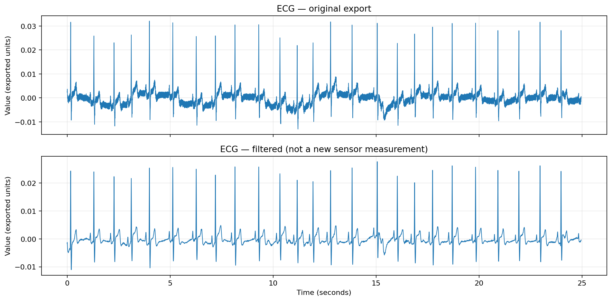

# HackEdge — AFE4950 Biosignal Processing

HackEdge is our project for working with heart-related sensor data using the **Texas Instruments AFE4950EVM** board.

Right now, we are using the board and TI's Bio-Sensing application to record data. Once we save that recording as a CSV file, this Python project reads it, filters out some of the unwanted noise, and gives us a cleaner signal to look at.

The goal is to make it easier to study the data before we move on to bigger parts of the project.

## What we're using

- **AFE4950EVM board:** Receives and measures signals from a connected sensor.
- **ECG or optical sensor:** The sensor we connect depends on what we want to measure.
- **TI Bio-Sensing application:** Shows the sensor data and lets us save a recording.
- **Python + VS Code:** Reads that recording and cleans it up.

Our process looks like this:

```text
Sensor  -->  AFE4950EVM board  -->  USB  -->  TI Bio-Sensing app
                                                 |
                                          Export captured CSV
                                                 |
                                       Python (this repository)
                                                 |
                                   Cleaned CSV files + signal graphs
```

**One thing to know:** The board is capable of measuring ECG and PPG, but they are different measurements. A filtered ECG is still ECG. We **cannot get a real, measured PPG signal from ECG, or a real ECG from PPG, just by removing noise.** Predicting one from the other would be a separate experiment that needs training data and testing.

## 1. Set up the board

1. Get the **AFE4950EVM**, the USB cable, and the correct sensor/cable for the type of signal you want to record.
2. Find the **AFE4950EVM user's guide** on [TI's official board page](https://www.ti.com/tool/AFE4950EVM). TI may require you to request access to the guide and software.
3. With the board disconnected from USB, attach the sensor **only as shown in that guide**. The connector and setup are different for optical and ECG measurements; don't guess the pins.
4. Connect the EVM to your computer using its USB cable.
5. Open TI's **Bio-Sensing** application and select the AFE4950EVM setup. Follow TI's instructions for configuring the ECG or optical sensor and checking the waveform.
6. Record some data and **export the captured waveform as a CSV file**.

**Safety:** If you are connecting electrodes to a person, have someone qualified check the setup and electrical isolation first. Follow TI's safety instructions. This is a student research/data-processing project, not a medical device.

The Python code starts **after** the file is exported. It does not control the board or read USB data directly.

For more setup details, see [docs/BOARD_SETUP.md](docs/BOARD_SETUP.md).

## 2. Open the project in VS Code

Download this repository and unzip it. In **VS Code**, choose **File → Open Folder**, select `hackedge-afe4950`, and open **Terminal → New Terminal**.

Make sure Python 3.10 or newer is installed.

On **Windows**, run:

```powershell
py -3 -m venv .venv
.\.venv\Scripts\Activate.ps1
python -m pip install -r requirements.txt
```

On **Mac/Linux**, run:

```bash
python3 -m venv .venv
source .venv/bin/activate
python -m pip install -r requirements.txt
```

This installs the Python libraries we use for the math, CSV files, and graphs.

## 3. Clean the sample recording

We've included a real example of the captured CSV format so you can try the code right away.

In the VS Code terminal, run:

```bash
python run.py --input data/examples/AFE4950_CAPTURED_DATA.csv
```

The script will make an `outputs/` folder containing:

| File | What it is |
| --- | --- |
| `ecg_cleaned.csv` | Original ECG data and filtered ECG data, with timestamps |
| `optical_cleaned.csv` | Original and filtered TIA1-3 optical-channel values |
| `ecg_comparison.png` | Graph showing ECG before and after filtering |
| `optical_comparison.png` | Graph showing the optical channel before and after filtering |
| `summary.json` | Basic details like sample rate, number of samples, and filter settings |

The `.csv` output has three columns: `time_s`, `original_value`, and `filtered_value`. We keep the original values so you can compare them with the cleaned version. The code doesn't overwrite your recording.



You can also open the [optical channel example](assets/optical_example.png).

## 4. Use your own recording

Export a new **captured waveform** from the Bio-Sensing app, then run:

```bash
python run.py --input "C:/path/to/your/AFE4950_CAPTURED_DATA.csv"
```

Replace that path with the location where you saved the file. If you only recorded ECG, use:

```bash
python run.py --input "C:/path/to/your/data.csv" --channel ecg
```

If you only recorded the optical/TIA channel, use:

```bash
python run.py --input "C:/path/to/your/data.csv" --channel optical
```

To choose where the output files go:

```bash
python run.py --input data/examples/AFE4950_CAPTURED_DATA.csv --output my_results
```

If your exported channel has a different label, you can also specify it with `--ecg-column` or `--optical-column`, as long as the file includes the corresponding `_Time` column.

## 5. What the code actually does

1. **Reads the file:** Finds ECG and TIA1-3 samples and their timestamps. Each signal has its own sample rate, so the code keeps them separate.
2. **Checks the data:** Makes sure there are enough samples and that their timestamps are evenly spaced.
3. **Removes some noise:** Uses a Butterworth bandpass filter. This reduces slow baseline movement and higher-frequency noise.
4. **Saves everything:** Makes cleaned CSV files, graphs, and a short summary.

The default filter settings are:

| Signal | Filter range | Why |
| --- | --- | --- |
| ECG | **0.5–40 Hz** | Keeps much of the ECG shape while reducing drift and faster noise |
| TIA1-3 / optical | **0.5–8 Hz** | Keeps slower pulse-related changes while reducing faster noise |

These are **starting settings for this project**, not guaranteed to be the best choice for every sensor or experiment. A filter can also remove useful information, so we always save and plot the original signal too.

The filtering is done after recording, not live. It uses a forward-and-backward method, so it is not a real-time filter.

## What is in the example files?

- `data/examples/AFE4950_CAPTURED_DATA.csv` is a real waveform export. In this file, the ECG column has **12,480 samples at 500 Hz**, and the TIA1-3 column has **1,248 samples at 50 Hz**. Both cover about 25 seconds.
- `data/examples/AFE4950_LIVE_DATA.csv` is **not** a waveform. It only contains summary information shown by the app (such as mean and peak-to-peak values). The cleaning script intentionally doesn't use it.
- The export also has `ECG_RAW`, `TIA1-3_RAW`, and an `AFE_REG_6D` register column. This project uses the app's `ECG_Value` and `TIA1-3_Value` columns because they already contain the exported signal values. It doesn't treat register values or raw digital counts as heart measurements.

**Note about TIA1-3:** This is an optical receive-path channel, but it is only a meaningful PPG waveform if the sensor, LED timing, and configuration were actually set up to record PPG. The code cannot confirm that from the CSV alone.

**Privacy:** The included capture is an example from our development data. If it was recorded from a real person, remove or replace it before sharing a *public* GitHub repository. Put future private captures in `data/private/`, which Git ignores.

## Project files

```text
hackedge-afe4950/
├── README.md
├── run.py                   # Run this to process a recording
├── requirements.txt         # Libraries to install
├── hackedge/
│   ├── io.py                 # Reads the exported CSV correctly
│   ├── filters.py            # Filters the signal
│   └── visualize.py          # Makes before/after graphs
├── data/
│   └── examples/             # Our example capture and live summary
├── docs/
│   └── BOARD_SETUP.md        # More detail about the setup
├── assets/
│   ├── ecg_example.png       # ECG example result
│   └── optical_example.png   # Optical example result
├── tests/                    # Checks that the code works
└── .github/workflows/        # Runs the tests on GitHub
```

To check that everything is working:

```bash
python -m unittest discover -s tests -v
```

## What's next for HackEdge?

For now, our main goal is to **get clean, usable recordings from the AFE4950**. The next stage would be to collect paired ECG and PPG recordings, compare their timing, and investigate whether a model can *estimate* one signal from the other. Those estimates would need careful testing and must be labeled as estimates, not sensor measurements.

For the technical details behind the filtering, see [docs/SIGNAL_PROCESSING.md](docs/SIGNAL_PROCESSING.md).

## References

- [Texas Instruments AFE4950EVM board page](https://www.ti.com/tool/AFE4950EVM) — hardware, user guide access, and official resources.
- [Texas Instruments AFE4950 product page](https://www.ti.com/product/AFE4950) — information about ECG and optical sensing capabilities.

*This project is for learning and engineering research. It is not designed to diagnose, monitor, or treat any medical condition.*
